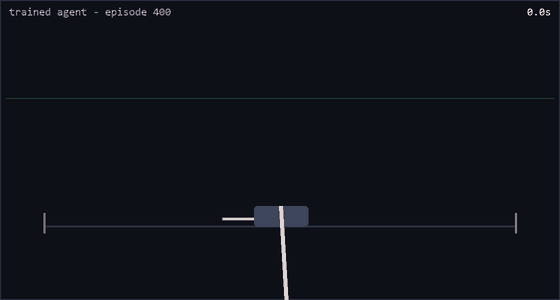
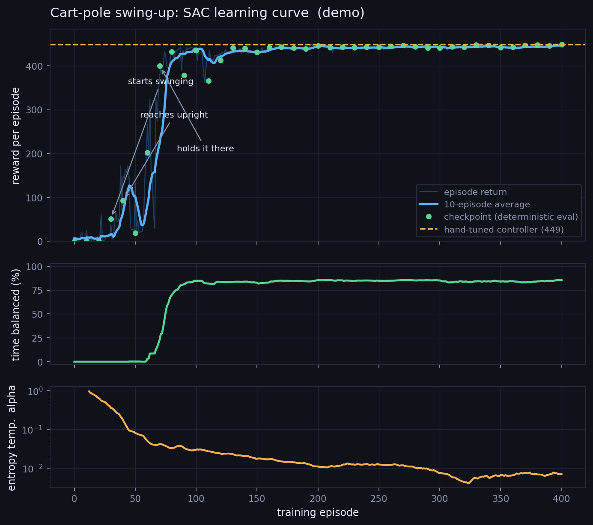
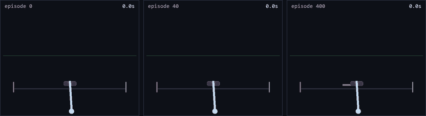

# 振り上げ倒立振子

正直な物理モデルによる台車型倒立振子の振り上げ環境と、それをゼロから学習する
Soft Actor-Critic エージェント、そして学習の過程を聴衆に見せるために作った2つの
ビューア（インタラクティブな pygame ウィンドウと、保存したチェックポイントを横並びで
再生する Web ページ）です。

強化学習についてのライトニングトークのデモとして作りました。



棒そのものには動力がありません。操作できるのは台車への水平方向の力だけで、レールは
左右それぞれ 2.4 m、力の上限は棒を直接持ち上げるには小さすぎます。そのため、振って
勢いをつけてから、上で受け止める必要があります。下部のオレンジ色のバーは加えている力を
表し、本当にバランスが取れているときは棒が緑色になります。

## ざっくり言うと

短いレールの上に台車があり、その上に棒がヒンジでつながって垂れ下がっています。できるのは
台車を左右に押すことだけで、棒を直接回すものは何もありません。目標は棒を真っ直ぐ上に
立て、その状態を保つことです。

これは見た目以上に難しく、押す力の上限は棒を一気に跳ね上げられないように設定されています。
台車を前後に揺らして振りを大きくし、倒れる前に頂点で棒を受け止めなければなりません。
`play.py` で自分でも試せますが、ほとんどの人はできません。

このリポジトリの中身を順番に紹介します。

1. **シミュレータ。** `swingup/physics.py` は、加えた力に応じて台車と棒が重力の下で
   どう動くかを計算します。運動方程式はコピーではなく自分で導出したもので、ヒンジと
   レールにわずかな摩擦を入れているため、棒が永遠に揺れ続けることはありません。
   シミュレーション時間 1 秒あたり 50 回ステップを進めます。

2. **スコア。** `swingup/env.py` は毎ステップ 0 から 1 の数値を返します。レールの中央付近で
   完全に直立して静止していれば 1、垂れ下がっていれば 0 です。学習器に伝えられるのは
   このスコア *だけ* です。重力や運動量のこと、振り上げとバランスが別々の仕事であることは、
   誰も教えていません。

3. **学習器。** `swingup/sac.py` は Soft Actor-Critic エージェントです。いろいろ試し、
   何が起きたかを記憶し、スコアが良かった行動へ少しずつ寄っていくニューラルネットワーク
   です。約 200 行で、PyTorch 以外の機械学習ライブラリは使っていません。

4. **スナップショット付きの学習。** `train.py` は 10 秒の試行を 400 回行い、10 回ごとに
   ネットワークのコピーと、そのコピーの公平なテストスコアを保存します。これにより、
   役立たずの段階から熟練の段階まで、学習のどの時点でも後から再生できます。

5. **2つの見方。** `play.py` はインタラクティブなウィンドウで、自分で操作したり、保存済みの
   任意のスナップショットに操作を任せたり、棒を突いて立て直す様子を見たりできます。
   `web/index.html` は複数のスナップショットを、同じ初期状態から横並びで同期再生します。

**何が起きたか。** 最初の 30 回は無意味にじたばたし、30 回目あたりで振り始め、40 回目で
初めて垂直に達し、50 回目あたりで一時的に *悪化* し、70 回目には安定してバランスを
取れるようになりました。ノート PC の CPU で約 2 分です。最終的に、現実的な上限 約 450 に
対して 約 448 のスコアで頭打ちになりました。



比較のため、`swingup/baseline.py` に同じ問題に対する従来型の設計による解法を入れています。
スコアはほぼ同じ 約 449 です。興味深い違いはスコアではなく、それぞれのアプローチが人間に
何を求めたかで、それは後述の表にまとめています。

## クイックスタート

```bash
pip install -r requirements.txt

python train.py --episodes 400 --run demo    # CPU で約 15 分
python play.py  --run demo                   # インタラクティブビューア
python export_replay.py --run demo           # Web リプレイを生成
python plot_metrics.py --run demo --dark     # スライド用の学習曲線
python make_gifs.py                          # README 用アニメーション（リプレイから生成）
```

その後、ブラウザで `web/index.html` を開いてください（サーバー不要、ファイルを直接開くだけで動きます）。

## タスク

棒は垂れ下がっています。台車は左右に押すことができ、それが *唯一の* 入力です。ヒンジを
直接駆動するものはありません。力の上限は、棒を一度の動きで跳ね上げられないように意図的に
設定されています。エージェントは前後に振って、往復ごとにエネルギーを加え、頂点で棒を受け止めて
保持しなければなりません。

レールは、ひたすら加速し続けるという素朴な戦略が失敗する程度に短くなっています。
*レールの中央付近に留まりながら* エネルギーを送り込むことを学ぶのが、本当の難しさです。

## 物理

`swingup/physics.py`。コピーではなくラグランジアンから導出しているため、減衰と棒の慣性
モーメントが正しい位置に入っています。`th` は **直立** から測るので、`th = 0` が目標、
`th = pi` が垂れ下がった状態です。

`J = (4/3) m l²` をピボット周りの棒の慣性モーメントとすると、加速度は次を解いて得られます。

```
| M+m          m l cos(th) | | xdd  |   | F - b_cart·xd + m l sin(th)·thd²  |
| m l cos(th)  J           | | thdd | = | m g l sin(th) - b_pole·thd        |
```

**RK4** で 50 Hz、1 制御ステップあたり 2 サブステップで積分しています。Euler 法は意図的に
採用しませんでした。これはエネルギー整形のタスクであり、Euler 法のステップごとのエネルギー
ドリフトは、まさに RL エージェントが見つけて悪用するたぐいのものだからです。テストでは、
シミュレーション時間 50 秒でのドリフトが `1e-5` J 未満であることを確認しています。

### 空気抵抗は悪いアイデアか？

良いアイデアなので残しましたが、小さくしています。粘性項が2つあり、ヒンジに
`b_pole = 0.02`、レールに `b_cart = 0.05` です。

- **残す理由**：摩擦のない棒はエネルギーを完全に保存するので、方策は棒を直立させて
  あとは惰性に任せることができてしまいます。減衰があると、バランスを保つために小さな修正を
  絶えず続ける必要があり、それは *見た目にも* 面白く、実機の挙動とも一致します。
- **小さくする理由**：減衰はエネルギーの送り込みと競合します。大きくすると振り上げに
  必要な振動回数が増え、学習が遅くなり、ある時点で力の上限ではまったく打ち勝てなくなります。
- **二乗ではなく線形にした理由**：本物の空気抵抗は `v²` に比例し、`swingup/physics.py` に
  `b2·thd·|thd|` の項を加えるのは簡単です。しかしここでの速度（1.2 m の棒で 約 10 rad/s 未満）
  では線形項と見た目で区別がつかず、調整するパラメータが増えるだけです。トーク用には線形のほうが
  良いトレードオフです。

比較するには `PhysicsParams` で `b_cart=0, b_pole=0` を設定してください。教科書的な
ベンチマークは摩擦なしなので、このモードも用意しておく価値があります。

## 報酬

タスク全体は `swingup/env.py` の1行で定義されています。

```python
upright  = (1 + cos(th)) / 2                 # 垂れ下がりで 0、直立で 1
slow     = 1 / (1 + 0.1·thd²)                # 棒が静止しているとき 1
centered = 1 / (1 + 0.5·(x / x_limit)²)      # レール中央で 1
reward   = upright · (0.5 + 0.5·slow) · centered − 0.002·action²
```

各項は **掛け算** されており、これが重要な設計判断です。足し算にすると、垂れ下がっているときも
含めてあらゆる場所で角速度にペナルティがかかります。それはエージェントが最初に発見しなければ
ならない行動そのものを罰することになり、振ることをまったく学ばなくなります。掛け算にすると、
静止のペナルティが `upright` で制御されます。下で速く回ってもほとんどコストはかかりませんが、
上で速く回ると報酬の大部分を失います。まさにそれを確認するテスト
（`test_velocity_penalty_is_gated_by_uprightness`）があります。

報酬は1ステップあたり最大 1.0 なので、500 ステップのエピソードで完璧なら 500 です。振り上げ
そのものに 約 60 ステップかかるため、現実的な上限は 約 450 になります。

## エージェント

`swingup/sac.py` — Soft Actor-Critic、約 200 行、RL ライブラリなし。トークの途中でどの行でも
指し示せるようにしています。

- **観測（5次元）**：`[x/x_limit, xd/5, cos(th), sin(th), thd/10]`。生の角度ではなく
  `cos`/`sin` を使うことで、ネットワークが ±pi での不連続を見ないようにしています。
  割る数は各入力をおおよそ単位スケールに保つためです。
- **行動（1次元）**：`[-1, 1]` の連続値の力で、±15 N にスケーリングされます。
- **SAC を選んだ理由**：バランスには垂直付近での細かい力の調整が必要で、左／なし／右の
  離散行動空間はこれが苦手です。また、学習されるエントロピー温度が、誰もノイズスケジュールを
  手で調整しなくても、最初の振り上げ成功にたどり着くための探索を提供してくれます。
- 128×128 の MLP、`min` ターゲットを使うツインクリティック、`tau = 0.005` のターゲット
  ネットワーク、バッチサイズ 256、`gamma = 0.99`。

### 古典的なベースライン

`swingup/baseline.py` は同じタスクを学習なしで解きます。Åström–Furuta のエネルギー
送り込み制御で、垂直から 0.6 rad 以内に入ると線形フィードバックに切り替えます。
スコアは **約 449** です。

これは *比較対象* としてリポジトリに入れており、比較のポイントはスコアではありません
（SAC も同等のスコアです）。それぞれが何を必要としたかです。

| | 手動調整のコントローラ | SAC |
|---|---|---|
| 運動方程式が必要 | はい | いいえ |
| 質量・長さ・重力が必要 | はい | いいえ |
| 手で選んだゲインが必要 | 5 個 | なし |
| 振り上げとバランスが別の問題だと誰かが気づく必要 | はい | いいえ |
| 報酬関数が必要 | いいえ | はい |
| 約 200 エピソード分の経験が必要 | いいえ | はい |

## チェックポイントと学習の再生

`train.py` は 10 エピソードごとにチェックポイントを書き出し、*さらに* シード固定の決定論的な
評価を実行します。そのため、エピソード 40 のスコアとエピソード 300 のスコアを直接比較できます。

```
runs/demo/
  config.json      この実行の物理・報酬・SAC の設定
  metrics.csv      学習エピソードごとに 1 行
  checkpoints/     ep00000.pt, ep00010.pt, ... latest.pt
  manifest.json    各チェックポイントの評価スコア付きインデックス
  curve_dark.png   学習曲線
```

エピソード 0 は **学習前に** 保存されるので、未学習でじたばたする方策をいつでも「ビフォー」の
クリップとして使えます。



*3つのチェックポイントを、同じ初期状態、同じ乱数シードで同期再生しています。左：ランダムに
押し、2 秒でレールから外れる。中央：頂点まで届くが、そのまま通り過ぎてしまう。右：頂点に達して
保持する。3つの違いは、方策がどれだけ練習したかだけです。*

`export_replay.py` は均等間隔のエピソードではなく、物語の節目（未学習、初めての本格的な振り、
初めての直立、初めてのバランス、ベスト）を選びます。「エピソード 120」よりも「初めて垂直に
達した瞬間」のほうがスライドとして良いからです。

## ビューア

### `play.py` — インタラクティブ

| キー | |
|---|---|
| `←` `→` | 台車を押す（人間モード） |
| `TAB` | HUMAN → AGENT → BASELINE を切り替え |
| `[` `]` | 前／次のチェックポイント |
| `0`–`9` | 学習の 0%–90% の地点へジャンプ |
| `E` | ベストのチェックポイントへジャンプ |
| `P` | ランダムな衝撃で棒を突く |
| `,` `.` | 棒をその場で短く／長くする |
| `R` `SPACE` `-` `=` `T` | リセット、一時停止、遅く、速く、軌跡 |

### `web/index.html` — リプレイ

クリップのチップで任意の数のチェックポイントを選ぶと、同じ初期状態・同じシードから
**同期して** 再生されるので、パネル間の違いは方策の学習量だけになります。クリック可能な
チェックポイントの点が付いた学習曲線も含まれています。

## 5分間の構成

1. **（45 秒）問題を見せる。** `play.py` を HUMAN モードで。自分で振り上げに挑戦します。
   その場で失敗してみせるのが最高の導入で、「左右に押す」ことと「棒を直立させる」ことが、
   一筋縄ではいかない関係にあることを聴衆はすぐに理解します。
2. **（45 秒）エージェントが受け取る形でタスクを説明する。** 5つの数値が入り、1つの数値が
   出る、そして報酬の1行。エネルギーも運動量も、2段階の制御のことも、誰も教えていません。
3. **（90 秒）学習を見せる。** Web ページで3つのパネルを同期再生：未学習、初めての直立、ベスト。
   次に学習曲線を見せ、エピソード 50 付近の *悪化した* 落ち込みを指し示します。その落ち込みこそが
   RL の正直な部分で、誰もが身に覚えがあります。
4. **（60 秒）教えていないことを見せる。** `P` を押して、バランスしている棒を突きます。立て直します。
   誰も立て直しの動作を書いていません。それは、たまたま行き着いたあらゆる状態から直立することに
   報酬を与えられた結果、自然に生まれたものです。
5. **（45 秒）比較で締める。** 上の古典的コントローラとの比較表。同じスコアで、エンジニアに
   求められるものはまったく違います。
6. **（15 秒）おまけの一撃。** `.` を何回か押して棒を長くします。方策は劣化し、やがて失敗します。
   それが sim-to-real ギャップを、キー1つで示したものです。

## 試してみる価値のあること

- `python train.py --force-mag 10 --run weak` — 手動調整のコントローラが垂直から 35° で
  止まってしまうほど力の上限が低い設定。それでも SAC は方法を見つけられるか？
- `python train.py --seed 3 --run seed3` — RL の実行ごとのばらつきは大きく、正直に見せる
  価値があります。シードによっては振り上げを見つけるのがずっと遅くなります。
- `RewardParams(vel_weight=0.0)` を設定して再学習し、報酬設計の重要性を確かめる。
- `derivative()` に二乗抵抗の項 `b2·thd·|thd|` を加え、それなしで学習した方策がそのまま
  通用するか確かめる。

## テスト

```bash
python -m pytest tests -q
```

24 個のテストがあり、ほとんどは物理の不変量です。減衰なしでのエネルギー保存、水平方向の
運動量保存、減衰がエネルギーを *増やさない* こと、RK4 が 10 倍細かい積分器と一致すること、
垂れ下がりが安定で直立が不安定であること、そしてエージェントが依存する報酬整形の性質です。

これらのテストがあるのは、壊れたシミュレータは壊れて見える方策を生まないからです。生まれるのは
素晴らしいスコアを出しながら不条理な振る舞いをする方策で、バグが表面化するのはずっと後になります。
